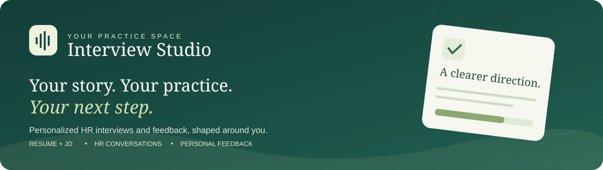
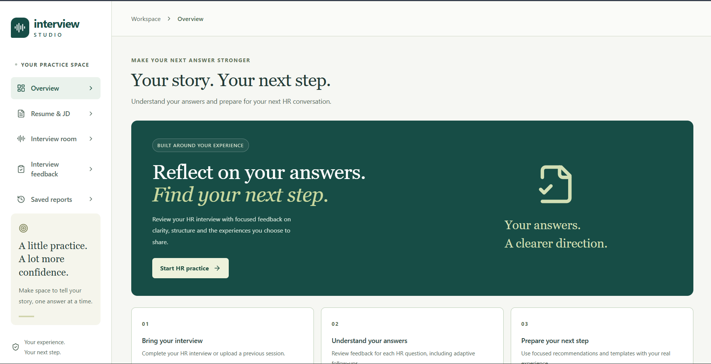
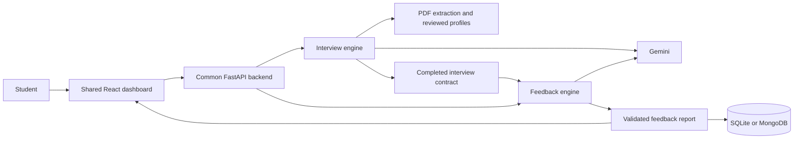

<div align="center">



# Interview Studio

### AI-Powered HR Interview Preparation & Personalized Feedback

Practice with your experience. Reflect on your answers. Prepare for your next opportunity.

<p>
  
  
  
  
  
  
</p>

[Overview](#project-overview) · [Homepage](#homepage-preview) · [Quick Start](#quick-start) · [API](#api-reference) · [Team](#team)

</div>

---

## Project Overview

**Interview Studio** is a browser-based HR interview practice platform for students. It connects resume and job-description review, personalized questions, interactive practice and answer feedback in one shared dashboard.

Questions focus on **HR, behavioral and situational conversations**: teamwork, motivation, communication, ownership, adaptability and reflection. Projects and technologies supply background for those conversations; they are not used to ask coding exercises or technical theory questions.

The experience follows one connected path:

**Resume + JD → Review → Interview → Answer feedback → Next steps**

## Contents

- [Homepage preview](#homepage-preview)
- [Features](#features)
- [Technology stack](#technology-stack)
- [Architecture](#architecture)
- [Quick start](#quick-start)
- [How to use](#how-to-use)
- [Configuration](#configuration)
- [Drafts and completed interviews](#drafts-and-completed-interviews)
- [Feedback and storage](#feedback-and-storage)
- [API reference](#api-reference)
- [Project structure](#project-structure)
- [Testing](#testing)
- [Troubleshooting](#troubleshooting)
- [Team](#team)

## Homepage Preview

The shared workspace uses a green-and-cream interface with five sections: **Overview, Resume & JD, Interview room, Interview feedback, and Saved reports**.



## Features

| Area | What you can do |
|---|---|
| **Resume & JD** | Upload text-based PDFs, paste a JD, review extracted text and edit the profile before practice. |
| **Profile comparison** | Compare reviewed skills with the job requirements and inspect matches and gaps. |
| **Personalized HR questions** | Set the role, category, reflection depth and question count. Questions draw on both reviewed documents. |
| **Interactive interview** | Start directly into practice and see one question at a time, without a full question-set preview. |
| **Text and voice** | Type answers or use optional browser speech recognition; finalized transcripts remain editable. |
| **Adaptive follow-ups** | Request a question grounded in your actual answer, with one follow-up per primary question and up to five per interview. |
| **Progress and recovery** | Pause/resume, navigate questions, review answers and optionally save a recovery draft in your browser. |
| **Answer feedback** | Review relevance, clarity, structure, completeness and examples on a 0–100 rubric. |
| **Practice recommendations** | Get specific next steps and suggested answer structures with placeholders for your real experience. |
| **Reports and history** | Download completed sessions and feedback reports, or reopen saved reports. |

Gemini prepares the question plan in the background, then the room presents questions individually. Follow-ups are generated on request from the current answer. Provider failures show errors rather than fixed questions or fabricated scores.

## Technology Stack

| Layer | Technologies |
|---|---|
| Frontend | React 19.2, Vite 7, JavaScript, Tailwind CSS 4, custom CSS, Lucide icons |
| Backend | Python, FastAPI, Uvicorn, Pydantic 2, Pydantic Settings |
| AI | Google Gemini through the Google Gen AI SDK |
| Document extraction | PyMuPDF and multipart file uploads |
| Voice input | Browser `SpeechRecognition` / `webkitSpeechRecognition` |
| Default report storage | SQLite |
| Optional report storage | MongoDB through PyMongo |
| Browser recovery | Local storage and downloadable JSON backups |
| Verification | pytest, FastAPI TestClient, mocked Gemini HTTP transport and Node's test runner |

Exact dependency versions are recorded in [backend/requirements.txt](backend/requirements.txt) and [frontend/package.json](frontend/package.json).

## Architecture



The root **`frontend/`** owns the common dashboard, navigation and theme. The root **`backend/`** exposes both modules through the same API. Interview and feedback logic remain in their respective module folders.

## Quick Start

### Requirements

- Python **3.11 or later**.
- Node.js **20.19+ on the 20.x line, or 22.12+**, and npm.
- A Gemini API key with available quota for question generation and feedback.
- MongoDB only if you choose it instead of the default SQLite storage.

### 1. Get the project

```powershell
git clone https://github.com/Akshay001-A/AI-HR-Interview-System.git
cd AI-HR-Interview-System
```

If you already have the project, open its root folder instead. Stop older development servers before starting another server on the same port.

### 2. Install the backend and configure Gemini

```powershell
python -m venv backend/.venv
.\backend\.venv\Scripts\python.exe -m pip install -r backend/requirements.txt

if (!(Test-Path .env)) { Copy-Item .env.example .env }
notepad .env
```

Set the key in the **root `.env`**, save and close the editor:

```dotenv
GEMINI_API_KEY=your_actual_api_key
```

The root configuration is shared by both engines. The interview engine also supports its older module `.env` as a compatibility fallback; root values take precedence over that file. Keep real credentials out of Git and frontend environment variables.

### 3. Start the backend

From the project root:

```powershell
.\backend\.venv\Scripts\python.exe -m uvicorn backend.main:app --reload --host 127.0.0.1 --port 8000
```

API documentation: **[http://127.0.0.1:8000/docs](http://127.0.0.1:8000/docs)**.

### 4. Start the frontend

In a second terminal, from the project root:

```powershell
cd frontend
npm ci
npm run dev
```

Open **[http://127.0.0.1:5173](http://127.0.0.1:5173)**, or the address printed by Vite if that port is occupied.

On later runs, you only need to start the two servers. Reinstall dependencies when their requirement or lock files change.

<details>
<summary>macOS / Linux backend commands</summary>

```bash
python3 -m venv backend/.venv
backend/.venv/bin/python -m pip install -r backend/requirements.txt
[ -f .env ] || cp .env.example .env
# Edit .env and add GEMINI_API_KEY before starting the API.
backend/.venv/bin/python -m uvicorn backend.main:app --reload --host 127.0.0.1 --port 8000
```

Frontend commands remain `cd frontend`, `npm ci`, and `npm run dev`.

</details>

## How to Use

1. **Prepare your documents.** Open **Resume & JD**. Upload your resume PDF and either upload a JD PDF or paste the job description.
2. **Review the extracted information.** Check the full text and editable profile fields, then compare the reviewed skills with the job requirements.
3. **Start your HR interview.** Open **Interview room**, choose your settings and browser recovery preference, confirm document review, and select **Start interview**.
4. **Answer one question at a time.** Type or start the microphone yourself. Pause when needed and optionally request an HR follow-up after entering at least 20 answer characters.
5. **Complete your interview.** Answer every question, including follow-ups, review the answers and select **Complete interview**. The session moves directly into feedback review.
6. **Request feedback.** Review the included context, confirm the Gemini disclosure, and select **Get interview feedback**.
7. **Reflect and return.** Explore the overview, answer feedback, text insights and next steps. Download the report or reopen it from **Saved reports**.

You can also upload a previously exported **completed interview JSON** directly to **Interview feedback**. Recovering a completed browser session exposes **Review feedback** in the interview room.

### Voice and timing

Microphone access starts only after your action. Recognition availability, permissions, language support and connectivity depend on the browser and device. Some browser speech services may send audio to their provider; the interface explains this before use. Typed answers remain available if voice fails.

The timer measures **active engagement**, including reading, typing and editing. It is **not speech-only time**. Reports do not derive speaking speed, vocal confidence or grammar accuracy from that timer. Text insights show word counts and possible filler-pattern matches with their limitations.

## Configuration

Use [.env.example](.env.example) as the starting point.

| Variable | Purpose / default |
|---|---|
| `GEMINI_API_KEY` | Server-side key required for AI requests. |
| `GEMINI_MODEL` | Primary model; see the repository's example configuration. |
| `GEMINI_FALLBACK_MODELS` | JSON array of alternate model IDs. |
| `GEMINI_REQUEST_BUDGET_SECONDS` | Overall AI request budget; default `60`. |
| `GEMINI_MODEL_TIMEOUT_SECONDS` | Per-model timeout; default `18`. |
| `STORAGE_BACKEND` | `sqlite` by default, or `mongodb`. |
| `SQLITE_PATH` | Optional override for the local database path. |
| `MONGODB_URI` | MongoDB connection string when that storage backend is selected. |
| `DATABASE_NAME` | MongoDB database; default `ai_hr_interview`. |
| `CORS_ORIGINS` | JSON array of allowed frontend origins. |

For a different API port, set the frontend terminal's `BACKEND_ORIGIN` before starting Vite:

```powershell
$env:BACKEND_ORIGIN = "http://127.0.0.1:8002"
npm run dev
```

Start the backend on that same port. The root frontend proxies `/api` to the backend. `VITE_API_BASE` can configure a separate API origin when needed; it must never contain an API key.

## Drafts and Completed Interviews

| File | Purpose | Where to use it |
|---|---|---|
| `interview-draft.json` | Recovery backup containing progress, question context and answers so far. | **Interview room → Load saved plan or draft**. |
| `completed-interview.json` | A validated session with every question answered. | **Interview feedback**, or the direct completed-session handoff. |
| `feedback-<session_id>.json` | Downloaded feedback report. | Keep as an exported record; reopen saved reports through the app's history. |

An unfinished draft is not a completed interview. For example, a draft with **3 of 6 answers** must be restored in the interview room and finished before feedback can be requested.

Browser recovery keeps one draft per origin/browser profile and includes document context and answers. Changing the port, hostname or browser profile changes that storage location. Use draft downloads when moving between them.

### Shared contracts

- [interview.schema.json](contracts/interview.schema.json): completed interview output.
- [feedback-input.schema.json](contracts/feedback-input.schema.json): normalized feedback input.
- [feedback.schema.json](contracts/feedback.schema.json): feedback report version `2.0`.
- [Contract documentation](contracts/README.md): compatibility and validation details.

Feedback accepts question text repeated inside an answer, or resolves it from the separate question list by ID. It validates exact question/answer matching, unique IDs, primary counts and follow-up relationships. Empty or incomplete sessions are rejected before evaluation.

## Feedback and Storage

### Feedback rubric

Each answer is assessed for **relevance, clarity, structure, completeness and examples**, with integer scores from 0 to 100. The application derives answer scores, criterion averages and the overall score from the validated rubric. A legitimate zero remains zero.

Feedback includes strengths, areas to develop, next steps and suggested answer templates. Templates use placeholders for details missing from the answer and must be completed with the candidate's real experience. Scores describe practice answers; they are not hiring decisions or placement predictions.

### Report persistence

**SQLite is the default.** Reports are stored in `.cache/feedback.sqlite3` and survive application restarts without a separate database service.

To use MongoDB instead, configure the root `.env`:

```dotenv
STORAGE_BACKEND=mongodb
MONGODB_URI=mongodb://localhost:27017/
DATABASE_NAME=ai_hr_interview
```

The MongoDB adapter uses a unique session ID index and upserts reports by session. Storage does not silently switch to memory. If saving fails, generated feedback remains available with `storage.saved=false`, and the UI asks you to download it.

Reports contain answers, feedback and session metadata. Raw resume/JD context is not stored in the feedback report. Recovery drafts do contain document context. Uploaded PDF files are not retained in application storage.

## API Reference

| Method | Endpoint | Purpose |
|---|---|---|
| GET | `/api/health` | Service health. |
| GET | `/api/interview/options` | Interview settings and generation availability. |
| POST | `/api/interview/resume` | Extract a text-based resume PDF. |
| POST | `/api/interview/jd` | Extract a JD PDF or accept pasted JD text. |
| POST | `/api/interview/analyze` | Compare reviewed profiles and skills. |
| POST | `/api/interview/generate` | Generate a personalized HR question plan. |
| POST | `/api/interview/plan/validate` | Validate an imported question plan. |
| POST | `/api/interview/draft/validate` | Validate a recovered plan and follow-ups. |
| POST | `/api/interview/followup` | Generate an answer-dependent HR follow-up. |
| POST | `/api/interview/complete` | Validate and return a completed interview. |
| POST | `/api/feedback/validate` | Normalize a session without AI evaluation or saving. |
| POST | `/api/feedback/evaluate` | Generate Gemini feedback and attempt report persistence. |
| GET | `/api/feedback/report/{session_id}` | Retrieve a saved report. |
| GET | `/api/feedback/history?limit=20&offset=0` | List paginated report summaries. |

Resume/JD PDFs support **1–20 pages**, with a default **10 MB** upload limit. Pasted JD text supports **20–30,000 characters**. Feedback JSON uploads are capped at **2 MB**. Image-only/scanned PDFs need a text layer; OCR is not included.

The older module launchers are compatibility entry points. Use the root frontend and backend commands above for the shared application.

## Project Structure

```text
AI-HR-Interview-System/
├── backend/                       # Common API, configuration and contracts
│   ├── main.py
│   ├── config.py
│   ├── contracts.py
│   └── requirements*.txt
├── frontend/                      # Shared React dashboard and theme
│   ├── src/
│   │   ├── App.jsx
│   │   ├── Workspace.jsx
│   │   ├── api.js
│   │   └── feedback.js
│   ├── package.json
│   └── vite.config.js
├── modules/
│   ├── interview_engine/
│   │   ├── backend/               # PDF extraction, questions and sessions
│   │   ├── frontend/              # Document preparation and interview room
│   │   ├── PHASE3.md
│   │   └── PHASE4.md
│   └── feedback_engine/
│       ├── backend/               # Evaluation, text analysis and persistence
│       └── frontend/              # Report, answer feedback and next steps
├── contracts/                     # Versioned JSON schemas
├── docs/images/                   # README banner and homepage screenshot
├── test_charan_api.py
├── test_shared_integration.py
├── .env.example
└── README.md
```

## Testing

Install development dependencies, then run the backend and integration suites from the root:

```powershell
.\backend\.venv\Scripts\python.exe -m pip install -r backend/requirements-dev.txt
.\backend\.venv\Scripts\python.exe -m pytest modules/interview_engine/backend/tests test_charan_api.py test_shared_integration.py -q
```

Run shared frontend checks and create a production build:

```powershell
cd frontend
npm test
npm run build
```

Optional interview session/voice tests, from the project root:

```powershell
npm --prefix modules/interview_engine/frontend ci
npm --prefix modules/interview_engine/frontend test
```

Coverage areas include document extraction, contract validation, question grounding, model failover, follow-up links, answer timing, recovery, voice lifecycle, scoring validation, storage failures and the completed-interview-to-feedback handoff. Automated provider tests use synthetic data and mocked HTTP transport, not live credentials.

## Troubleshooting

| Symptom | What to check |
|---|---|
| **Only three navigation tabs appear** | Stop the old servers, start the root frontend/backend, then refresh the browser. The combined dashboard has five tabs. |
| **Gemini quota/rate-limit error** | Check the project's quota in Google AI Studio and wait for the relevant reset or review its API usage tier. Another key in the same project does not reset that project's quota. |
| **Feedback is not configured** | Add `GEMINI_API_KEY` to the root `.env` and restart the backend. |
| **A draft is rejected by feedback upload** | Restore it in Interview room, finish every answer, and use Review feedback or export the completed interview. |
| **My draft disappeared after changing the URL** | Browser drafts are scoped to the origin. Return to the original hostname/port/profile or import a downloaded draft. |
| **Microphone is unavailable** | Check browser support and permissions; continue with typed answers if recognition cannot start. |
| **PDF text cannot be extracted** | Use an unlocked, text-based PDF within the page/size limits. |
| **Report generated but not saved** | Download it immediately, then check the configured SQLite path or MongoDB connection. |
| **Port already in use** | Stop the older server or use matching alternate frontend/backend configuration. |

AI requests use bounded model failover, timeouts and attempt limits. Authentication and quota errors stop rather than cycling models indefinitely. No fixed questions or substitute evaluation scores are created after provider failure.

## Team

| Contributor | Primary contribution |
|---|---|
| **Akshay R** | Interview engine, document preparation, HR question generation, interactive practice and Studio UI. |
| **Charan Kumar R** | Feedback engine, answer evaluation, communication analysis, recommendations and report persistence. |

Department of Information Science and Engineering, **M. S. Ramaiah Institute of Technology, Bengaluru**.

Contributions should preserve the shared contracts, keep question generation HR-focused, and include relevant checks for changed behavior. Submit changes through a branch and pull request.

<div align="center">

**Your experience. Your ambitions. Your interview.**

[Explore the repository](https://github.com/Akshay001-A/AI-HR-Interview-System) · [Report an issue](https://github.com/Akshay001-A/AI-HR-Interview-System/issues)

</div>
